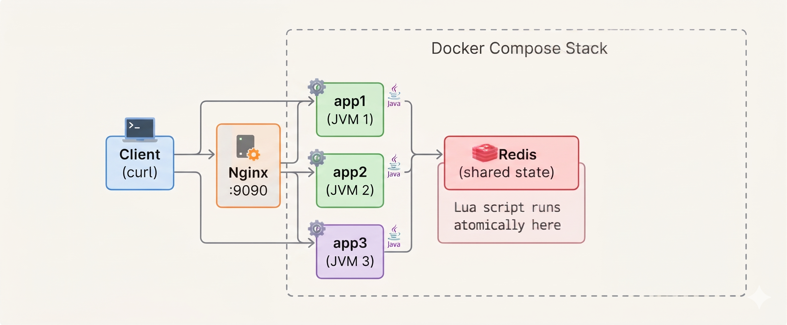

# DistLimit

A distributed rate limiter in Java that enforces request limits across multiple service instances using Redis atomic Lua scripting.

**Problem it solves:** Without shared state, 3 replicas each allow 10 requests = 30 total instead of 10. DistLimit proves this doesn't happen.

## Architecture



## Quick Start

```bash
git clone https://github.com/pbanakar/distlimit.git
cd distlimit && docker compose up -d --build
# After all containers are healthy, run the load test:
docker compose exec redis redis-cli FLUSHALL
docker run --rm --network distlimit_default -v "${PWD}/loadtest:/scripts" \
  -e TARGET_URL=http://nginx:80 -e CLIENT_ID=test grafana/k6:latest run /scripts/load-test.js
```

## Load Test Results

| Test | Sent | Allowed | Rejected | Correct? |
|------|------|---------|----------|----------|
| **Distributed** (Nginx → 3 instances) | 50 | 10 | 40 | ✅ |
| **Single instance** (app1 only) | 50 | 10 | 40 | ✅ |

Both identical — distributing across 3 JVMs changed nothing about correctness.

## Configurable policies

Requests can select a named policy with the optional `policy` parameter:

```bash
curl -X POST "http://localhost:8080/api/v1/rate-limit/check?clientId=alice&policy=premium"
```

Policies are configured independently in `application.yml`. For example,
`free` and `premium` can use different capacities and refill rates while
keeping separate Redis buckets for the same client. The `default` policy is
used when `policy` is omitted.

## Documentation

| Doc | What's in it |
|-----|-------------|
| [Architecture](docs/architecture.md) | System diagram, layer explanations, request lifecycle walkthrough |
| [Algorithms](docs/algorithms.md) | Token Bucket vs Sliding Window comparison, clock injection pattern |
| [Design Decisions](docs/design-decisions.md) | Every choice explained: what, why, alternatives, tradeoffs |
| [Load Test Results](docs/load-test-results.md) | Measured numbers, what they prove, what failure looks like |
| [Redis Atomicity](docs/redis-atomicity.md) | Why GET-SET fails, Lua fix, EVAL vs EVALSHA, script walkthrough |
| [Contributing](CONTRIBUTING.md) | Prerequisites, how to run tests, commit format |
| [Full Guide](docs/guide.md) | End-to-end walkthrough for learning the project from scratch |
